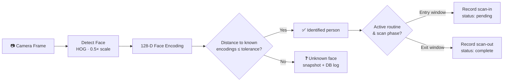
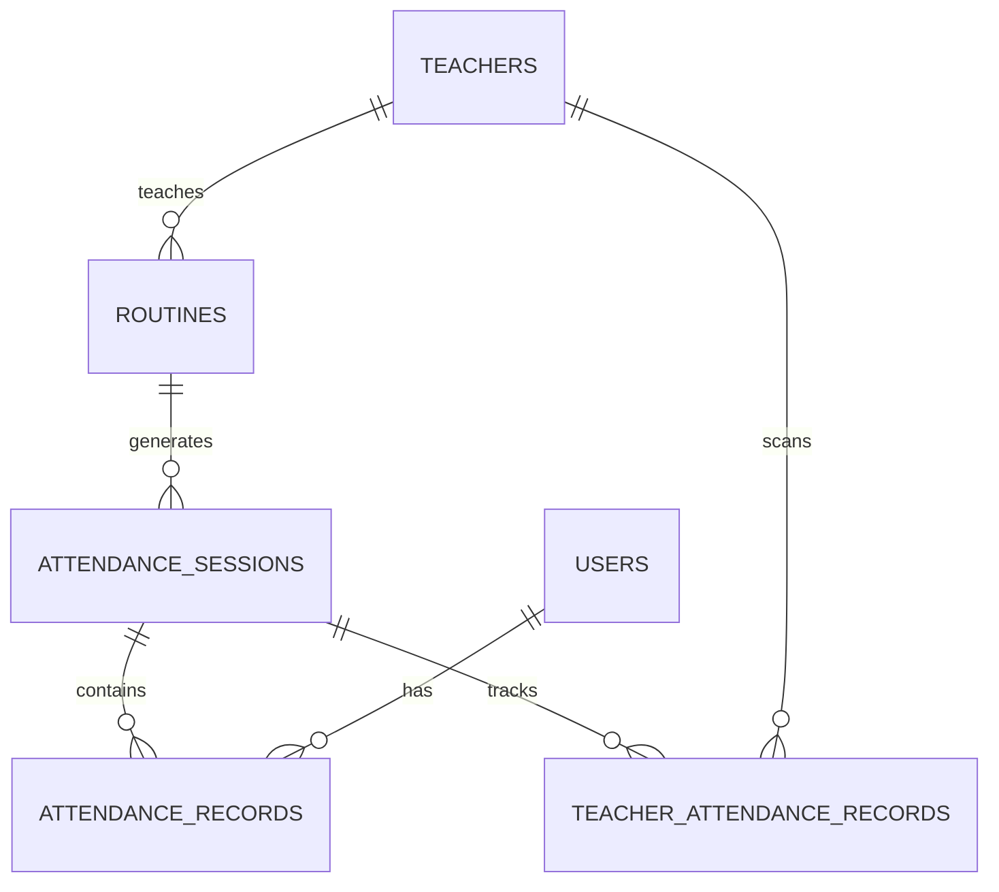

<div align="center">

# 🎓 Face Recognition Attendance System

### Contactless, automated class attendance for students and teachers — powered by facial recognition

<p>
  
  
  
  
  
</p>

<p>
  
  
  
  
</p>

**Built for Barishal Polytechnic Institute**

[Features](#-features) · [How It Works](#-how-it-works) · [Quick Start](#-quick-start) · [Configuration](#-configuration) · [Project Structure](#-project-structure) · [Troubleshooting](#-troubleshooting)

</div>

---

## 📖 Overview

**Face Recognition Attendance System** replaces paper rolls and manual roll-calls with a fast, desktop-based facial recognition workflow. Students and teachers simply look at a camera at the start and end of a class; the system identifies them, matches the scan to the live class routine, and records a verified attendance entry in a MySQL database.

Administrators get a full management dashboard to approve registrations, manage teachers and class routines, review unrecognised faces, and export professional PDF / CSV reports.

---

## ✨ Features

<table>
<tr>
<td width="50%" valign="top">

### 👨‍🎓 Students
- Self-registration with **live face capture** (30-frame averaged encoding)
- Admin-approval workflow before activation
- Personal **student portal & dashboard** with attendance history
- View class routine by department, semester and shift

</td>
<td width="50%" valign="top">

### 🧑‍🏫 Teachers
- Face-based **scan-in / scan-out** per class session
- Automatic linking to the routine (subject, time, shift)
- Teacher attendance recorded alongside student attendance in reports

</td>
</tr>
<tr>
<td width="50%" valign="top">

### 🛡️ Administrators
- Secure login with **bcrypt-hashed** passwords
- Dashboard overview with 7-day attendance chart
- Manage **students, teachers and routines** (add / list / edit)
- Approve or reject **pending registration requests**
- Review **unknown-face captures** with timestamp & snapshot
- Export **PDF and CSV** reports (per session, filtered, or all)

</td>
<td width="50%" valign="top">

### ⚙️ System
- **Two-phase attendance** (entry + exit) to prevent proxy attendance
- Optimised recognition pipeline (HOG detector, half-resolution frames)
- **Multi-camera** support via IP Webcam (mobile phones as cameras)
- Modern **dark / light theme** toggle, animated splash & transitions
- MySQL **connection pooling** and parameterised queries
- Packaged into a standalone app with **PyInstaller**

</td>
</tr>
</table>

---

## 🔍 How It Works



### Attendance windows

Each class defines a start and end time. Attendance is only accepted inside two short windows:

| Phase | Window | Result |
|---|---|---|
| 🟢 **Entry** | `class_start` → `class_start + 10 min` | Record created as `pending` |
| 🟡 **Between** | after entry window, before exit window | Scans not counted |
| 🔴 **Exit** | `class_end − 10 min` → `class_end` | Record upgraded to `complete` |

A student is marked **present** only when both scans are completed. The window length is configurable in `services/routine_service.py` (`ENTRY_WINDOW_MIN`, `EXIT_WINDOW_MIN`).

### User roles

| Role | Access |
|---|---|
| **Student** | Register, log in, scan attendance, view personal records and routine |
| **Teacher** | Scan attendance for assigned classes (managed by admin) |
| **Admin** | Full management dashboard, approvals, reports |

---

## 🧰 Tech Stack

| Layer | Technology |
|---|---|
| Language | Python 3.10+ |
| Face recognition | `face_recognition` (dlib), OpenCV, NumPy, Pillow |
| GUI | CustomTkinter, CTkTable, tkcalendar |
| Database | MySQL 8 · `mysql-connector-python` (pooled) |
| Reports | pandas, openpyxl, ReportLab (PDF), matplotlib |
| Security | bcrypt, python-dotenv |
| Packaging | PyInstaller |

---

## 🚀 Quick Start

### Prerequisites

- **Python 3.10 or newer**
- **MySQL Server 8.x** (running locally or on your network)
- A **webcam** (or a phone running an IP-camera app)
- **CMake** and a C++ build toolchain — required to compile `dlib`
  - Windows: *Visual Studio Build Tools* → "Desktop development with C++"
  - Linux: `sudo apt install build-essential cmake`

### 1. Get the project

```bash
git clone <your-repository-url>
cd Face_Recognaton_System_FIXED
```

### 2. Create a virtual environment

```bash
python -m venv venv

# Windows
venv\Scripts\activate
# Linux / macOS
source venv/bin/activate
```

### 3. Install dependencies

Install `dlib` first, then the rest:

```bash
pip install cmake
pip install dlib
pip install -r requirements.txt
pip install pymysql      # used by the database layer
```

> 💡 **Windows tip:** if `dlib` fails to build, install a pre-built wheel matching your Python version.

### 4. Create the database

```bash
mysql -u root -p -e "CREATE DATABASE IF NOT EXISTS face_attendance_db CHARACTER SET utf8mb4;"
mysql -u root -p face_attendance_db < database/schema.sql
```

### 5. Configure environment

Create a `.env` file in the project root (or run `python setup.py` to generate it interactively):

```env
DB_HOST=localhost
DB_PORT=3306
DB_USER=root
DB_PASSWORD=your_mysql_password
DB_NAME=face_attendance_db
SECRET_KEY=change-me-to-a-long-random-string
```

### 6. Create the admin account

```bash
python setup.py
```

You will be prompted for an admin username and password; the password is stored as a bcrypt hash.

### 7. Run

```bash
python main.py
```

The app checks the database connection, shows the splash screen, and opens the main page.

---

## ⚙️ Configuration

All application settings live in [`config.py`](config.py); credentials come from `.env`.

| Setting | Default | Description |
|---|---|---|
| `FACE_CAPTURE_COUNT` | `30` | Frames captured and averaged during registration |
| `FACE_TOLERANCE` | `0.5` | Match threshold — **lower = stricter** (0.4 strict · 0.6 lenient) |
| `WEBCAM_INDEX` | `0` | Primary camera index |
| `EXTRA_CAMERAS` | `[None, None]` | IP-camera URLs, e.g. `"http://192.168.x.x:8080/video"` |
| `SPLASH_DURATION_MS` | `3500` | Splash screen duration |
| `APPEARANCE_MODE` | `"dark"` | Default UI theme (`dark` / `light`) |
| `INSTITUTION` | `Barishal Polytechnic Institute` | Name shown in the UI and reports |

### 📱 Using phones as extra cameras

1. Install an **IP Webcam** app on the phone and start the server.
2. Make sure the phone and PC are on the same Wi-Fi network.
3. Add the stream URL in `config.py`:

```python
EXTRA_CAMERAS = [
    "http://192.168.0.101:8080/video",
    None,
]
```

---

## 🗄️ Database Design



| Table | Purpose |
|---|---|
| `admins` | Administrator credentials (bcrypt hash) |
| `users` | Approved students with face encodings |
| `registration_requests` | Pending / rejected self-registrations |
| `teachers` | Teacher profiles with face encodings |
| `routines` | Weekly class schedule (department, semester, shift, time) |
| `attendance_sessions` | One row per class held on a given date |
| `attendance_records` | Student scan-in / scan-out per session |
| `teacher_attendance_records` | Teacher scan-in / scan-out per session *(auto-created)* |
| `unknown_face_logs` | Unrecognised face snapshots and timestamps |

---

## 📂 Project Structure

```text
Face_Recognaton_System_FIXED/
├── main.py                  # Application entry point
├── config.py                # Settings & constants
├── theme.py                 # Dark / light theme manager
├── transitions.py           # Animated page transitions
├── setup.py                 # First-time setup (env + admin account)
├── build.py                 # PyInstaller build script
├── fix_admin_hash.py        # Utility: reset an admin password hash
├── requirements.txt
│
├── database/
│   ├── db_connection.py     # Connection handling & query helpers
│   └── schema.sql           # Database schema
│
├── models/                  # Data-access layer
│   ├── admin_model.py
│   ├── user_model.py
│   ├── teacher_model.py
│   ├── routine_model.py
│   └── report_model.py
│
├── services/                # Business logic
│   ├── face_service.py          # Encoding, matching, unknown-face logging
│   ├── face_capture_widget.py   # Live capture widget for registration
│   ├── attendance_service.py    # Scan-in / scan-out rules
│   ├── routine_service.py       # Active-routine & phase detection
│   └── report_service.py        # PDF / CSV export
│
├── views/                   # GUI screens
│   ├── splash_screen.py
│   ├── main_page.py
│   ├── face_scanner.py          # Live attendance scanner
│   ├── student_register.py / student_login.py
│   ├── student_portal.py / student_dashboard.py
│   ├── admin_login.py / admin_dashboard.py
│   └── admin_pages/             # Admin sub-pages
│       ├── dashboard_home.py    ├── user_add.py / user_list.py
│       ├── teacher_add.py       ├── teacher_list.py
│       ├── routine_add.py       ├── routine_list.py
│       ├── pending_requests.py  ├── unknown_faces.py
│       └── report_view.py
│
└── assets/                  # Images & captured unknown faces
```

---

## 📦 Build a Standalone App

Package the application with PyInstaller:

```bash
python build.py
```

Output: `dist/FaceAttendance/` (`FaceAttendance.exe` on Windows).

When distributing the build to another machine:

1. Copy the whole `dist/FaceAttendance/` folder together with your `.env` file.
2. Install and start **MySQL** on the target machine.
3. Import `database/schema.sql` and run the admin setup.

---

## 🔒 Security Notes

- Passwords are stored with **bcrypt**; face data is stored as serialised numeric encodings, **not images**.
- All SQL uses **parameterised queries**.
- **Never commit `.env`** — add it to `.gitignore`.
- Change the default admin credentials and `SECRET_KEY` before deploying.
- Face encodings are biometric data: restrict database access and follow your institution's privacy policy.

---

## 🛠️ Troubleshooting

| Problem | Solution |
|---|---|
| `dlib` fails to install | Install CMake and the C++ build tools first, or use a pre-built wheel |
| `Could not connect to the MySQL database` | Ensure the MySQL service is running and `.env` credentials are correct |
| `ModuleNotFoundError: pymysql` | Run `pip install pymysql` |
| Camera does not open | Check `WEBCAM_INDEX`, close other apps using the camera |
| Face not recognised | Improve lighting, face the camera directly, re-register; adjust `FACE_TOLERANCE` |
| Admin cannot log in | Run `python setup.py` to (re)create the admin password hash |
| Fewer than 20 valid frames at registration | Retry in brighter light with the full face visible |

---

## 🗺️ Roadmap

- [ ] Liveness / anti-spoofing detection (photo & video attack protection)
- [ ] SMS / email notifications for absentees
- [ ] Excel (`.xlsx`) report export
- [ ] Attendance analytics & charts per subject
- [ ] Web / mobile companion app

---

## 🤝 Contributing

Contributions are welcome.

1. Fork the repository
2. Create a feature branch: `git checkout -b feature/your-feature`
3. Commit your changes: `git commit -m "Add your feature"`
4. Push and open a Pull Request

---

## 📄 License

Distributed for educational use at **Barishal Polytechnic Institute**. Add a `LICENSE` file (e.g. MIT) to define reuse terms for your repository.

---

<div align="center">

**Face Recognition Attendance System · v1.0.0**

Made with ❤️ for smarter classrooms

</div>
